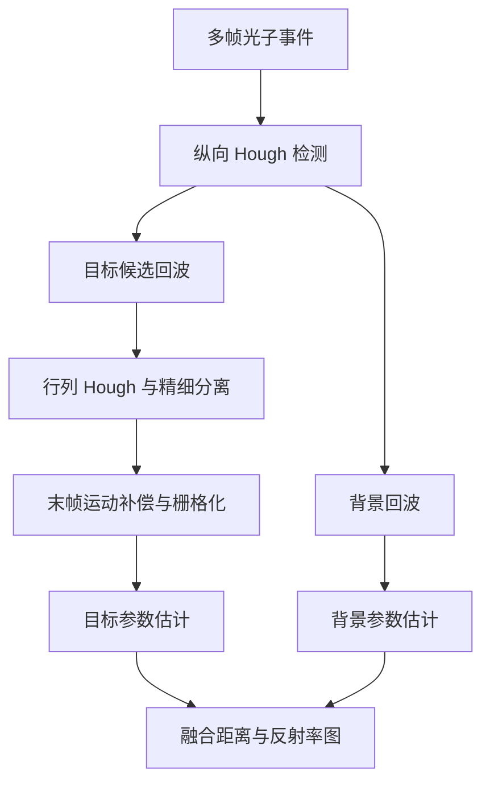

# 3D reconstruction of the dynamic scene with high-speed targets for GM-APD LiDAR

本公开仓库仅提供依据正式全文整理的笔记和引用；PDF 不在仓库内。[全文获取、版权原因与原始 PDF 页码说明](source.md)。文中 PDF 页码均沿用用户实际上传的文件页码。

## 文献信息

| 字段 | 内容 |
|---|---|
| 作者 | Di Liu; Jianfeng Sun; Wei Lu; Sining Li; Xin Zhou |
| 通讯作者 | Jianfeng Sun |
| 出版 | *Optics & Laser Technology*, 161, 109114, 2023 |
| 版本 | 正式发表版本；2023-01-17 在线发表；上传 PDF 共 10 页 |
| DOI | [10.1016/j.optlastec.2023.109114](https://doi.org/10.1016/j.optlastec.2023.109114) |
| 官方来源 | [ScienceDirect](https://www.sciencedirect.com/science/article/pii/S0030399223000075) |
| 文件 | [全文获取说明](source.md) · [BibTeX](citation.bib) · [仓库总览](../../README.md) |

本笔记依据上传全文整理。页码均为 PDF 文件页码；“原文”表示论文报告，“整理者归纳”表示阅读分析。书目信息见 [PDF p.1](source.md#pdf-page-1)。

## 摘要与研究问题

**原文：** GM-APD LiDAR 需要累积多脉冲观测才能估计距离和反射率，但高速目标在累积窗口内移动，使原本应集中的回波在距离、行和列方向扩散。本文先用 Hough transform 提取运动轨迹，再分离目标与背景、补偿运动、重新栅格化，最后进行参数估计；目标运动产生的亚像素采样还可用于超分辨率重建。[PDF pp.2–5](source.md#pdf-page-2)

**整理者归纳：** 关键是先把多帧观测对齐到一个参考时刻，让静态场景的统计估计工具可以处理动态目标。该方法同时提供运动分割和轨迹参数，不依赖训练神经网络。

## 背景、现有不足与贡献

- 直接峰值检测、匹配滤波和静态 3-D 反卷积没有显式解释高速目标的运动，距离和强度图都会模糊。[PDF pp.1–2、5–6](source.md#pdf-page-1)
- 采用分阶段 Hough 检测：先估计纵向运动，再在筛出的目标数据中估计行、列方向运动，避免直接进行高维参数搜索。[PDF pp.3–4](source.md#pdf-page-3)
- 将目标回波与背景分开，在统一参考时刻校正后分别估计、再融合场景。[PDF p.4](source.md#pdf-page-4)
- 将相对运动视作天然扫描，在光子数量充分时使用更细空间和时间栅格，实现横向及纵向超分辨率。[PDF pp.4–5](source.md#pdf-page-4)

## 方法与核心公式

### 1. 首次触发观测模型

原文式 (1)–(3) 给出同步复位 TDC 的检测概率：[PDF p.2](source.md#pdf-page-2)

```math
P_j=\exp\!\left(-\sum_{i=1}^{j-1}K_i\right)\left(1-e^{-K_j}\right),\qquad
K_j=\int_{(j-1)t_{\rm bin}}^{jt_{\rm bin}}R(t)\,dt,
```

```math
R(t)=r\,s(t-2d/c)+b.
```

$P_j$ 为第 $j$ 个时间 bin 首次触发的概率； $K_j$ 为该 bin 的积分光子量； $t_{\rm bin}$ 为 bin 宽度； $r,d,b$ 分别表示反射率、距离和背景光子率； $s$ 为脉冲波形， $c$ 为光速。运动使像素对应的 $r,d,b$ 随采样帧变化，直接累积不再对应固定场景。

### 2. 分阶段运动估计和数据分离

帧号 $l$ 与测得的距离 bin $\mathrm{bin}(l)$ 做 Hough 变换，原文式 (4)：[PDF p.3](source.md#pdf-page-3)

$$
\rho=l\cos\theta+\mathrm{bin}(l)\sin\theta.
$$

参数空间中的峰值给出目标轨迹。再依据预测回波 $`\mathrm{bin}_{\rm tgt}(l)`$ 及门宽 $`\mathrm{bin}_{\Delta}`$ 选择目标候选光子。对这些候选数据的行、列坐标分别重复 Hough 变换，得到 $\theta_m,\theta_n$；未归属目标的数据进入背景集合。[PDF pp.3–4，式 (7)–(14)](source.md#pdf-page-3)

### 3. 对齐到采集窗口末帧

令 $l_{\max}$ 为末帧，按原文式 (15)–(17) 校正：[PDF p.4](source.md#pdf-page-4)

$$
\widehat m(l)=m(l)+(l-l_{\max})\cot\theta_m,\qquad
\widehat n(l)=n(l)+(l-l_{\max})\cot\theta_n,
$$

$$
\widehat{\mathrm{bin}}(l)=\mathrm{bin}(l)+(l-l_{\max})\cot\theta.
$$

校正后的横向坐标可为非整数，随后根据像素大小与 TDC 精度重新划分体素，并对目标和背景分别估计距离与反射率。超分辨率使用更细栅格；它依赖该方向存在相对运动及充分数据，并非简单插值。[PDF pp.4–5](source.md#pdf-page-4)



## 系统参数与实验设置

| 项目 | 仿真 | 实测及等效处理 | 依据 |
|---|---|---|---|
| 探测器 | GM-APD，64 × 64 | GM-APD，64 × 64 | PDF pp.5、7 |
| 距离 | 约 1 km | 100 m | PDF pp.5、7 |
| 目标速度 | 飞行模型 300 m/s，接近方向角 30.4° | 主要行人实际 1.0–1.3 m/s；抽帧后等效 100–130 m/s | PDF pp.5、7 |
| 噪声条件 | 有效目标像素内 SBR 约 0.1 | SBR 约 5.86 | PDF pp.5、7 |
| 平均每像素光子数 | 原文未提供统一 PPP | 原文未提供统一 PPP | — |
| 窗口 | 40 ms | 原始采集 4 s，按 1/100 抽帧形成等效 40 ms、800 脉冲 | PDF pp.5、7 |
| 采集频率 | 本段未明确给出 | 激光及 GM-APD 为 20 kHz；系统按 25 Hz 重建窗口工作 | PDF p.7 |
| 视场 | 2° | 2° × 2° | PDF pp.5、7 |
| 原生纵向分辨率 | 0.15 m | TDC 1.25 ns，对应约 0.188 m | PDF pp.5、7 |
| 超分辨率栅格 | 256 × 256、纵向 0.075 m | 256 × 256、纵向 0.094 m | PDF pp.6–7 |

**解释边界：** 实验中的“100–130 m/s”来自慢速行人数据抽帧后的等效时间压缩，不是实际高速飞行器实测；25 Hz 是系统重建节拍，文中没有给出完整算法耗时，不能据此证明端到端实时处理。[PDF pp.7–9](source.md#pdf-page-7)

## 定量结果与对比

### 仿真：1 km、300 m/s、SBR 约 0.1、40 ms

| 方法 | 强度图 PSNR | 距离 RMSE |
|---|---:|---:|
| Peak picking | 0.17 dB | 2.72 m |
| Matched filtering | 1.24 dB | 1.83 m |
| 3-D deconvolution | 1.58 dB | 0.92 m |
| 本文方法 | 4.47 dB | 0.44 m |

以上为原文表 1。[PDF p.6](source.md#pdf-page-6) 注意本文 PSNR 使用反射率真值能量与误差能量的比值，不能不加说明地和其他论文的最大像素值 PSNR 直接比较。

- 同一仿真中，超分辨率结果为 PSNR 4.10 dB、RMSE 0.072 m；普通重建上采样到同样尺寸为 4.06 dB、0.168 m。比较对象和分辨率已变化，不能把这些数值直接与表 1 混为同一评测。[PDF p.6](source.md#pdf-page-6)
- 实测等效高速场景中，本文超分辨率结果为 PSNR 4.65 dB、RMSE 0.053 m，峰值检测为 1.23 dB、0.62 m。[PDF p.7](source.md#pdf-page-7)
- 纵向及两横向运动参数相对仿真真值的误差分别为 2.70%、3.45%、3.77%。[PDF p.6](source.md#pdf-page-6)

## 消融、适用条件与局限性

**原文证据：** 有普通重建上采样与运动超分辨率的对照，但没有完整逐模块消融矩阵。Hough 直线模型适合窗口内近似匀速的目标；目标须有足够事件且留在视场与距离门内。仅在窗口末段出现的小目标会漏检；人体形变引起的模糊无法通过刚体平移补偿消除。[PDF pp.5–9](source.md#pdf-page-5)

原文给出理想系统参数下的速度、加速度约束，但明确说明实际场景会改变这些约束。它们是理想条件分析，不能作为已验证的目标速度上限。[PDF p.6](source.md#pdf-page-6)

**作者后续工作：** 改进对加速直线运动、曲线运动等不同运动模型的适应性。[PDF p.9](source.md#pdf-page-9)

**整理者归纳：** 门宽、Hough 离散化和栅格尺寸影响目标保留率与计算量，复现时应先验证轨迹检测，再比较超分辨率，避免把漏检和距离估计误差混在一起。

## 代码、数据与复现线索

- 官方代码：上传全文未提供代码仓库或实现下载地址。
- 数据：原文明确表示所用数据保密，不是公开数据集。[PDF p.10](source.md#pdf-page-10)
- 复现需准备：带帧号、行列和 ToF bin 的原始事件；同步复位探测模型；脉冲/IRF、背景率、Hough 步长和目标门宽；参考时刻与更细栅格；匹配基线及本文 PSNR 定义。
- 缺少作者数据时，可依据第 5 节系统设置重建 Monte Carlo 仿真；自行补充的参数必须注明，不能宣称完全复现。

## 阅读总结

**整理者归纳：** 最值得借鉴的是“轨迹估计 → 光子分离 → 对齐后统计”的处理顺序，以及利用自然运动获得亚像素信息。它是后续事件驱动动态 LiDAR 方法的可理解基线，但证据中的实际高速与等效高速、原生分辨率与输出栅格、系统帧率与运算速度必须分别记录。
