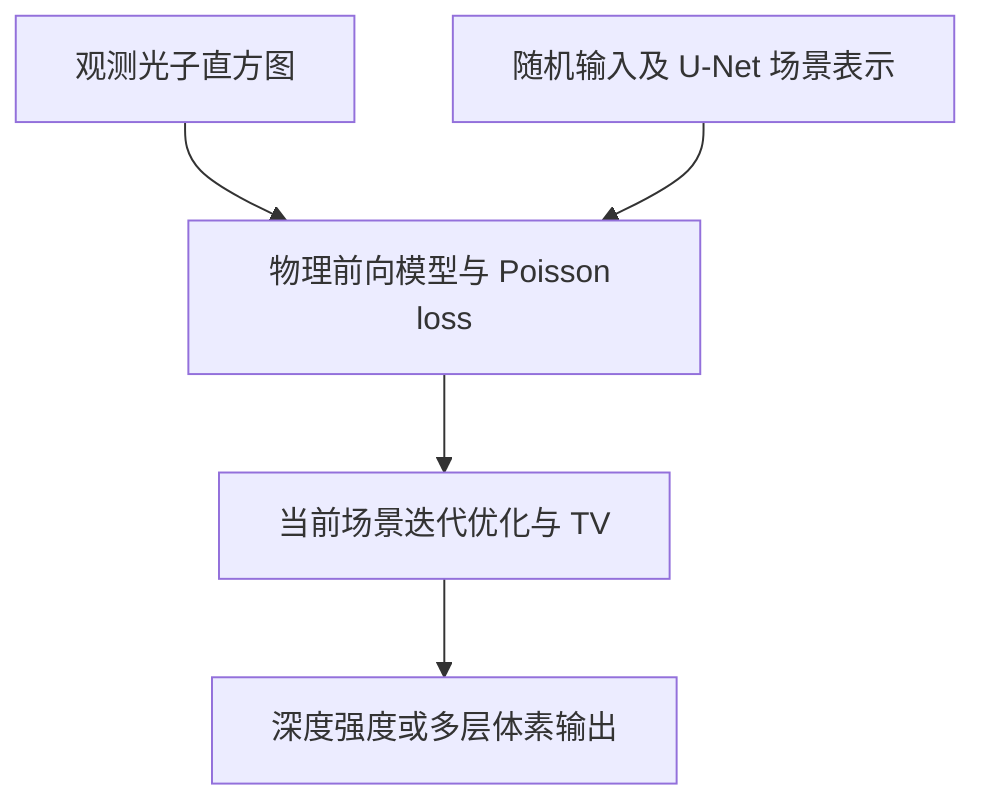

# Single-Photon Imaging in Complex Scenarios via Physics-Informed Deep Neural Networks

本公开仓库仅提供依据正式全文整理的笔记和引用；PDF 不在仓库内。[全文获取、版权原因与原始 PDF 页码说明](source.md)。文中 PDF 页码均沿用用户实际上传的文件页码。

## 文献信息与版本

- 作者：Siao Cai, Zhicheng Yu, Shaobing Gao, Zeyu Chen, Yiguang Liu；通讯作者 Yiguang Liu。
- 正式发表：*IEEE Transactions on Pattern Analysis and Machine Intelligence*, 48(5), 5827–5843, 2026；2026-01-15 首次在线发表，2026-04-03 当前版本日期，2026 年 5 月卷期。上传为 17 页正式期刊全文。[PDF p.1](source.md#pdf-page-1)
- DOI：[10.1109/TPAMI.2026.3654264](https://doi.org/10.1109/TPAMI.2026.3654264)；[IEEE 官方来源](https://ieeexplore.ieee.org/document/11355376)。
- 文件：[全文获取说明](source.md) · [BibTeX](citation.bib)。PDF p.1 对应期刊 p.5827。
- 原文明确注明个人使用可行，再出版／再分发需要 IEEE 许可。公开版不收录该 PDF，笔记许可不改变论文的再分发条件。[PDF p.1](source.md#pdf-page-1)

## 摘要（整理者归纳）

PIDNN 用神经网络参数化待恢复场景，以单光子物理前向模型和 Poisson 数据一致性对当前观测进行无监督优化。它通过控制 U-Net skip 数调节多尺度时空先验，处理低计数、低 SBR 和光斑导致的 multiple returns；再以 SDF 表面表示和体渲染扩展到多个沿视线深度，并以表面／雾双分支区分目标反射和体散射。验证覆盖模拟数据、室内实测、公开 21.6／45 km 长距离数据、磨砂玻璃遮挡和室内雾箱。本文的适应性来自每个观测场景的迭代拟合，不能解读成训练一次后即时推理；作者明确认为现有延迟不适合严格实时应用。[PDF pp.4–15](source.md#pdf-page-4)

## 背景、现有不足与贡献

本文区分四个问题：低光子数／低 SBR；光斑覆盖邻近不同表面的 **multiple returns**；透明／半透明遮挡造成沿光路多层的 **multiple depths**；雾的吸收与体散射。前两类统计相似但物理原因不同，单峰滤波和简单背景相减难以统一处理。监督模型对训练中未出现的 IRF、FoV 和散射条件易产生 domain shift。[PDF pp.1–4](source.md#pdf-page-1)

贡献是把可调整物理模型嵌入每场景优化，用网络结构的 implicit prior 加显式 TV 约束降低标签需求，并以 surface–volume 双分支利用雾的低频分布与目标的局部结构分离信号。作者“首次”的优先权表述在此仅作为原文主张，不进行独立历史认定。[PDF pp.2,6–8](source.md#pdf-page-2)

## 方法、核心公式与变量



**每场景拟合。**

```math
x=f_\theta(z),\qquad
\theta^*=\arg\min_\theta E(y,H(f_\theta(z))),\qquad x^*=f_{\theta^*}(z).
```

$y$ 为观测， $x$ 为场景响应， $z$ 为网络输入， $\theta$ 为针对当前观测优化的参数， $H$ 为物理前向算子；网络 architecture 自带隐式先验，而非仅靠训练样本。[PDF p.4, Eq.5](source.md#pdf-page-4)

**multiple returns 的测量。**

$$
R=G*x+B,\quad y\sim\mathrm{Poisson}(R),\quad
E(y,H(x))=\sum_{ijk}\left(R_{ijk}-y_{ijk}\log R_{ijk}\right).
$$

$G$ 为空间 PSF 与时间 pulse 的三维卷积核， $B$ 为背景， $R$ 为期望计数；原式可省略不依赖 $x$ 的常数。低通量近似忽略 pile-up。物理模型参数改变时可调整 $G$，但仍需对新观测优化网络。[PDF pp.4–5](source.md#pdf-page-4)

**沿路径透过率与表面表示。**

```math
T(t)=\exp\left[-\int_0^t\sigma(\tau)\,d\tau\right],\qquad
R^0_{ijk}=\int_{k\Delta}^{(k+1)\Delta}\frac{T_{ij}(t)^2\sigma_{ij}(t)I_{ij}(t)}{(ct)^2}\,dt.
```

$\sigma$ 为光学密度， $I$ 为反射／辐射项， $\Delta$ 为 bin 宽； $T^2$ 表示往返衰减。原文时间／路径参数定义见 Eq.10–11，不能从该式直接移植到其他系统而忽略距离标定与模型单位。[PDF p.5](source.md#pdf-page-5)

用 SDF $\phi$ 的零等值面表达表面，转为表面密度与 opacity $\alpha^s=1-e^{-\sigma^s}$；沿深度透过率为

```math
T^s_{ijk}=\prod_{l<k}(1-\alpha^s_{ijl}).
```

将表面贡献卷积回 $G$ 后与光子观测比较；沿视线多层输出保留体素，不强制压成一个深度。[PDF pp.5–7, Eqs.12–20](source.md#pdf-page-5)

**雾双分支。** 网络分别输出 $x_h=[\sigma^h,I^h]$ 和 $x_s=[\phi,I^s]$，雾／表面贡献按各自密度权重组合，再考虑联合透过率与 IRF：

$$
R^{h+s}=\frac{\sigma^h}{\sigma^h+\sigma^s}R^h+
\frac{\sigma^s}{\sigma^h+\sigma^s}R^s,\qquad R=G*R^{h+s}+B.
$$

雾分支不使用 skip、尺度更粗，以低频偏好表达填充介质；表面分支保留随 SBR 调节的 skip，采用较细表示。[PDF pp.6–7](source.md#pdf-page-6)

**显式 TV 与输出。**

$$
\mathcal L_{\rm total}=E(y,H(x))+10^{-6}\mathrm{TV}(\Lambda)+10^{-6}\mathrm{TV}(D).
$$

$\Lambda$、 $D$ 分别为强度和深度；深度通过时间轴 Softmax 加权估计，强度取时间轴最大响应。多层任务使用 $\alpha^sI^s$ 体素表达。[PDF p.7](source.md#pdf-page-7)

## 网络配置、训练与关键参数

| 项目 | 原文参数／范围 | 证据 |
|---|---|---|
| 网络与先验 | 7-stage U-Net，卷积+BN+LeakyReLU；平均池化，trilinear upsampling；表面分支 2×、雾分支 8× 尺度变化 | [pp.7–8](source.md#pdf-page-7) |
| 每场景优化 | Adam；表面 learning rate $10^{-4}$，雾 $2.5\times10^{-5}$；RTX 3090、i5-13600K | [p.7](source.md#pdf-page-7) |
| 初始化 | 默认随机；雾任务中两分支分别以模拟球面与均匀雾预训练初始化 | [p.7](source.md#pdf-page-7) |
| 迭代时间 | 原文报告平均 257 次迭代及 “average iteration time” 151.43 s；此处保留其原统计称谓，不把它改成完整帧重建时间 | [p.7](source.md#pdf-page-7) |
| 仿真 FoV／扫描步长 | per-pixel FoV 43.85／55.67／77.98／167.26 μrad；scan step 11.15 μrad | [pp.8–11](source.md#pdf-page-8) |
| 仿真光子条件 | 信号:背景包括 10:2 到 1:100；较低三组 3:100、2:100、1:100 不在被比较监督模型原训练条件中 | [pp.8–9](source.md#pdf-page-8) |
| 本文室内系统 | NTK-PILAS 皮秒激光，5 mW；SPCM-AQRH4 单 SPAD，dead time 22 ns；ID900 TCSPC，100 ps；滤光带宽 10 nm，振镜扫描 | [p.11](source.md#pdf-page-11) |
| 室内规模与 SBR | $128\times128\times256$ 观测体；两场景、SBR 0.133／0.022；扫描网格不是探测器阵列 | [pp.11–13](source.md#pdf-page-11) |
| 多深度测量 | 磨砂玻璃遮挡 SCU， $128\times128$；0.1 ms/pixel；平均 PPP 4.2，SBR 0.53 | [pp.13–14](source.md#pdf-page-13) |
| 雾测量 | 室内雾箱，676 nm、5 mW， $128\times128$ 扫描，100 ps TCSPC；本文未给足以对应外场气象能见度的定量参数 | [p.14](source.md#pdf-page-14) |
| 动态速度／重建 fps | 主要为静态场景，无实际 UAV 高速连续跟踪或在线 fps 验证 | [pp.11–15](source.md#pdf-page-11) |

原文称无监督、不需标签；雾实验仍使用模拟预训练初始化，不能把“不需标注数据”扩展为“从未使用任何模拟数据”。[PDF p.7](source.md#pdf-page-7)

## 实验与主要定量结果

**模拟 multiple returns，Table I：** 结果为深度／强度图 RMSE；表中未在数值列明确标注单位，这里保留原值，不拿它直接与其他论文的 m 制误差比较。[PDF p.9](source.md#pdf-page-9)

| 信号:背景 | Rapp 深度 RMSE | Lee | Lindell | Peng I | Peng II | PIDNN | PIDNN 强度 RMSE |
|---|---:|---:|---:|---:|---:|---:|---:|
| 10:2 | 0.1162 | 0.1151 | 0.0961 | 0.0875 | 0.0851 | 0.0847 | 0.0829 |
| 2:50 | 0.2467 | 0.3586 | 0.1772 | 0.1831 | 0.1769 | 0.1741 | 0.1653 |
| 3:100 | 0.2319 | 0.3687 | 0.2576 | 0.2084 | 0.1715 | 0.1523 | 0.1812 |
| 2:100 | 0.2903 | 0.6624 | 0.3518 | 0.2703 | 0.2503 | 0.1948 | 0.2289 |
| 1:100 | 0.4295 | 0.7831 | 0.5526 | 0.4099 | 0.3239 | 0.2559 | 0.2427 |

监督基线没有用极低 SBR 三组训练，是该泛化比较的重要条件；不是所有网络同训练分布的竞赛。Table II 在 FoV 167.26 μrad 给 PIDNN 深度 RMSE 0.1571，Peng II 为 0.1861；但 55.67 μrad 下 Peng II 0.1284 优于 PIDNN 0.1351。[PDF pp.8–10](source.md#pdf-page-8)

**本文室内实测，Table III：**

| 条件 | PIDNN 深度 RMSE（原表值） | Peng II | PIDNN 强度 RMSE |
|---|---:|---:|---:|
| Scene 1，SBR 0.133 | 0.1127 | 0.1395 | 0.1181 |
| Scene 1，SBR 0.022 | 0.1973 | 0.2016 | 0.1395 |
| Scene 2，SBR 0.133 | 0.0521 | 0.0562 | 0.1066 |
| Scene 2，SBR 0.022 | 0.1575 | 0.1621 | 0.1308 |

来源：[PDF p.13](source.md#pdf-page-13)。表题分别定义深度／强度 RMSE；它们不是目标定位误差或三维跟踪误差。

**公开长距离实测数据（来自 Li 等的原测量，不是本文重新搭建并采集）：**

| 场景 | 距离与扫描网格 | PPP／SBR | 获取与分析说明 |
|---|---|---|---|
| K11 Building | 21.6 km， $256\times256$ | 1.20／0.11 | 22 ms/pixel，激光 100 mW；35 μrad divergence，22.3 μrad receiving FoV |
| Pudong Civil Aviation Building | 45 km， $128\times128$ | 约 2.59／0.03 | 激光 120 mW；本文未给该场景每像素 dwell；同轴系统 |

来源：[PDF pp.11,13](source.md#pdf-page-11)。长距离比较主要为定性：PIDNN 与 Li 等传统方法总体相近，部分细节更好；没有提供完整 metric truth 下的长距离量化精度表。不能把室内 Table III 的误差移作 45 km 测距误差。

多层／雾实验给出三视图和回波分解：磨砂玻璃遮挡的多次反射伪厚度减轻，但 Sigmoid 连续梯度导致残余表面厚度；雾箱中本文能恢复较深的 C，展示表面与雾信号分离。没有量化“适用于任意浓雾”的能见度界限。[PDF pp.13–15](source.md#pdf-page-13)

## 消融、局限和作者后续工作

- TV 消融显示低 SBR 时训练 loss 持续下降可能同时出现重建误差回升；TV 有助于抑制噪声拟合。[PDF pp.7–8](source.md#pdf-page-7)
- skip 数实验：10:2 下全 skip 最好，5:50 下去掉两条达到最低误差，2:50 下减少 skip 更抗噪。这是详情／平滑先验的取舍，不存在所有场景最优的固定 skip 数。[PDF pp.8–9](source.md#pdf-page-8)
- 作者明确：迭代体素优化开销大，现有延迟使自动驾驶和机器人等严格实时部署几乎不可行。[PDF p.15](source.md#pdf-page-15)
- 后续：2D／3D 混合表示、渐进 coarse-to-fine 架构；纳入高通量 pile-up 与雾中 multiple scattering，更贴合物理过程的架构与多模态先验。[PDF p.15](source.md#pdf-page-15)
- 整理者判断：低频雾与高频目标的可分性是重要假设；局部突变雾或细密半透明结构可能难分离。本文实验支持特定采集与介质条件，尚未穷尽这些边界。

## 官方代码、数据与复现所需信息

- 上传全文未提供 PIDNN 官方代码／checkpoint／数据下载 URL；不能编造一个同名仓库当官方实现。
- Middlebury 与公开长距离数据有原论文出处（Refs.16、72、74），但上传全文未给直接数据下载入口。[PDF pp.16–17](source.md#pdf-page-16)
- 复现需要 measured IRF、空间 PSF／扫描步长、时间偏置、背景估计、按 SBR 选择的 skip 配置、体渲染和 SDF 参数、初始化及停止准则。正文已给学习率和部分 architecture，仍不足以保证独立实现与原结果完全一致。

## 阅读总结（整理者归纳）

最值得借鉴的是先区分多个相似回波现象的物理原因，再用可微前向模型连接场景表示与光子数据；网络结构本身可作为无需标签的先验。它适合质量优先、允许每场景迭代的复杂静态成像，与“训练一次后高速推理”和“高速 UAV 跨帧跟踪”应作为不同技术路线比较。
