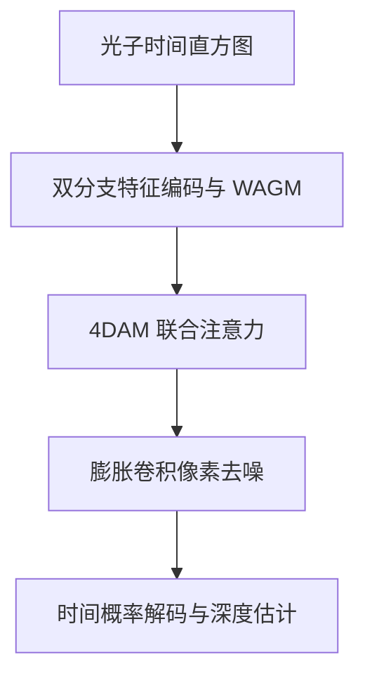

# Single-Photon Depth Reconstruction at Low Signal-Background Ratio Based on Four-Dimensional Attention Mechanism

本公开仓库收录原始 PDF，文件内容未修改。原文采用 [CC BY 4.0](https://creativecommons.org/licenses/by/4.0/)；版权与许可归原作者／出版商。完整作者和出处见下文；[PDF 许可清单](../../PDF_LICENSES.md)。

## 文献信息与证据范围

- 作者：Senlin Feng, Tong Liu, Jianghua Cheng, Bang Cheng, Yahui Cai, Yunwang Zhang；通讯作者 Tong Liu。
- 正式发表：*Remote Sensing*, 18, 2006, 2026；2026-06-16 发表。上传的是 20 页期刊全文，不是预印本或摘要页。[PDF p.1](paper.pdf#page=1)
- DOI：[10.3390/rs18122006](https://doi.org/10.3390/rs18122006)；[官方来源](https://www.mdpi.com/2072-4292/18/12/2006)。
- 文件：[原始 PDF](paper.pdf) · [BibTeX](citation.bib)。PDF 页码从文件第一页开始计数。
- 原文版权声明为 CC BY。本文笔记的释义与归纳不改变 PDF 原有许可。[PDF p.1](paper.pdf#page=1)

## 摘要（整理者归纳）

论文研究强背景噪声和稀疏信号下的单光子深度估计，提出监督学习网络 AMAD-Net。它以小波门控、通道／时间／频域／空间联合注意力及像素级膨胀卷积去噪提取弱回波，并用交叉熵和非局部总变差约束深度预测。在 Middlebury 八场景构建的测试光子数据上，信号／背景计数条件为 1:100 时，平均深度 RMSE 为 0.0219 m；1:300 时为 0.1131 m。证据主要来自模拟光子数据，正文未给出独立的公里级外场硬件验证，不能将远距离应用前景表述成已完成的实测。[PDF pp.12–18](paper.pdf#page=12)

## 背景、不足与贡献

1. 长距离回波弱、背景强；直接统计峰值和局部滤波容易把随机噪声峰当作目标，常规平滑又会损失边缘。[PDF pp.1–4](paper.pdf#page=1)
2. 网络将深度恢复转化为每像素时间 bin 分类；以 Wavelet Attention Gating Module（WAGM）改善前端信号表示，以 Four-Dimensional Attention Mechanism（4DAM）联合特征关联，以锯齿式 dilation 序列扩大去噪感受野。[PDF pp.5–11](paper.pdf#page=5)
3. 用 Non-Local Total Variation（NLTV）约束相似局部结构，缓解普通 TV 带来的边缘模糊；以模块与损失消融验证各部分作用。[PDF pp.11–12,17](paper.pdf#page=11)

“四维”指注意力处理的通道、时间、频域、空间特征，不是四个独立物理测量坐标；与运动论文的五维事件表示含义不同。[PDF pp.8–10](paper.pdf#page=8)

## 方法流程与核心公式

- 编码：标准与膨胀三维卷积分支形成互补感受野，时间轴约下采样 16 倍，特征通道数为 32。[PDF pp.5–6](paper.pdf#page=5)
- WAGM：通过 stationary wavelet transform 获取高频细节，再学习时空软掩码进行乘性门控。高频提取与学习门控共同作用，不能把所有高频成分直接认定为信号。[PDF pp.6–8](paper.pdf#page=6)
- 4DAM：通道注意力使用平均／最大池化和共享 MLP；时间分支分别提取局部包络和全局时间关联；结合 DFT 表示的空间注意力并自适应融合。[PDF pp.8–10](paper.pdf#page=8)
- 像素去噪：锯齿式 dilation 扩大感受野，GAP/GMP 与特征归一化生成自适应阈值，通过 soft-threshold、PReLU 和残差结构保留有效特征。[PDF pp.10–11](paper.pdf#page=10)

**时间分类与连续估计。** 为便于阅读统一下标；与原文等价的整理表达为

$$
p_{ij}(k)=\frac{\exp z_{ij}(k)}{\sum_{m=1}^{K}\exp z_{ij}(m)},\qquad
\hat\tau_{ij}=\sum_{k=1}^{K}k\,p_{ij}(k),\qquad
\hat d_{ij}=\frac{c\Delta}{2}\hat\tau_{ij}.
$$

$z_{ij}(k)$ 为像素 $(i,j)$ 第 $k$ 个时间 bin 的 logit，$K$ 为 bin 数，$\Delta$ 为时间 bin 宽度，$c$ 为光速。式中未写系统固定时间偏置；实际测量需依标定换算绝对距离。[PDF pp.5–6,11–12](paper.pdf#page=5)

**训练目标。** 原文使用 CE 与 NLTV 的加权组合：

$$
\mathcal L=\mathcal L_{\rm CE}+10^{-6}\mathcal L_{\rm NLTV},\qquad
\mathcal L_{\rm CE}=-\sum_{i,j,k}y_{ijk}\log p_{ij}(k),
$$

$$
\mathcal L_{\rm NLTV}=\frac1Z\sum_p\sum_{q\in W_p}w_{pq}|\hat d_p-\hat d_q|,
\qquad w_{pq}=\exp\!\left[-\frac{\operatorname{MSE}(P_p,P_q)}{h^2}\right].
$$

$y$ 为深度对应时间 bin 的 one-hot 标签，$P_p,P_q$ 为局部 patch，$W_p$ 为邻域，$h$ 控制相似性权重，$Z$ 为归一化项。实现配置为 patch 3、搜索窗口 5、noise weight 0.2；符号重排属整理表达，原式见正文。[PDF pp.11–12](paper.pdf#page=11)

光子建模要求激光重复周期 $T_r\ge 2R_{\max}/c$；正文以每脉冲触发概率低于 5% 为忽略 pile-up 的前提。因此强计数／饱和条件不能直接沿用该模型。[PDF p.5](paper.pdf#page=5)

## 数据、关键参数与实验设置

| 项目 | 原文记录与范围 | 证据 |
|---|---|---|
| 探测器、硬件阵列、绝对测距、目标速度 | 本文结果部分未提供独立实测系统参数；输入空间尺寸不等于硬件阵列规模 | [pp.12–19](paper.pdf#page=12) |
| 数据来源 | NYUv2 生成训练／验证光子数据，Middlebury 八场景测试 | [p.12](paper.pdf#page=12) |
| 训练／验证数量 | 13244／2753 | [p.12](paper.pdf#page=12) |
| 光子数据尺寸 | $64\times64\times1024$；训练随机 crop 为 $32\times32\times1024$ | [p.12](paper.pdf#page=12) |
| IRF 与时间 bin | IRF FWHM 400 ps；时间 bin 80 ps；该 bin 对应距离间隔约 12 mm（整理者按 $c\Delta/2$ 换算），不等于测距精度 | [p.12](paper.pdf#page=12) |
| SBR／光子数 | 原文按信号与背景平均计数的成对条件标记，如 1:100；不是 dB SNR，背景数不是每个 bin 的数值 | [pp.12,14,16](paper.pdf#page=12) |
| 采集时间、重建帧率、实测空间分辨率 | 原文未给出足以支持真实采集或实时处理的独立参数 | [pp.12–19](paper.pdf#page=12) |
| 训练配置 | batch 8，29 epochs；Adam，初始学习率 $10^{-3}$，每 3 epochs 乘 0.6，betas 0.9／0.999 | [p.12](paper.pdf#page=12) |
| 软件与设备 | Python 3.12.7，PyTorch 2.5.1，CUDA 12.4，Ubuntu 24.04.2，MATLAB 2024a；RTX 4080 SUPER 16 GB，i5-14600F | [p.12](paper.pdf#page=12) |

对比包括 LM、Shin、Rapp、Lindell、Peng、Yao；指标包括深度 RMSE、PSNR、SSIM、阈值 accuracy、AbsRel 与 SqRel。下列数值是八个测试场景的平均值。[PDF pp.13–15](paper.pdf#page=13)

| 信号:背景计数 | LM RMSE (m) | Rapp | Lindell | Peng | Yao | AMAD-Net | AMAD-Net PSNR (dB) | AMAD-Net SSIM |
|---|---:|---:|---:|---:|---:|---:|---:|---:|
| 1:100 | 6.8415 | 0.9464 | 0.7467 | 0.1691 | 0.0658 | 0.0219 | 41.4678 | 0.9556 |
| 2:50 | 5.8182 | 0.3122 | 0.1115 | 0.0192 | 0.0150 | 0.0133 | 45.6074 | 0.9799 |
| 2:100 | 6.1822 | 0.4807 | 0.1834 | 0.0309 | 0.0229 | 0.0146 | 44.7533 | 0.9762 |
| 3:100 | 5.5156 | 0.3100 | 0.1330 | 0.0153 | 0.0130 | 0.0124 | 46.1379 | 0.9823 |

来源：原文 Tables 3、4、6，[PDF p.14](paper.pdf#page=14)。1:100 时相对 Yao 的 RMSE 降幅约 66.7%，这是整理者由表内同条件数据计算，不是跨论文排名。

**极低 SBR 的边界。** Table 9 中，1:200、1:300、1:500 的 RMSE 分别为 0.0512、0.1131、0.5416 m，SSIM 分别为 0.9311、0.8900、0.4642；3:300 的 RMSE 为 0.0156 m。相同 SBR 不保证相同信息量，例如 1:100 与 3:300 的信号计数不同，误差也不同。[PDF p.16](paper.pdf#page=16)

## 消融与解释

- 1:100 条件下，去掉 WAGM、4DAM、DC 的 RMSE 分别为 0.0334、0.0228、0.0234 m，全模型为 0.0219 m。WAGM 单独保留、4DAM 单独保留、DC 单独保留分别为 0.0483、0.0640、0.0237 m。[PDF p.17, Table 10](paper.pdf#page=17)
- 1:200 条件下，WAGM+4DAM 的 RMSE 为 0.0462 m，略低于三模块的 0.0512 m，但全模型 SSIM 为 0.9311，高于该组合的 0.9232。因此不能声称所有条件、所有指标均随模块增加而单调改善。[PDF p.17](paper.pdf#page=17)
- 1:100 条件下，CE、CE+TV、CE+NLTV 的 RMSE 为 0.0305、0.0273、0.0219 m；PSNR 为 38.5743、40.3221、41.4678 dB。[PDF p.17, Table 11](paper.pdf#page=17)
- 原文消融正文写 1:100、2:100、3:100，但 Table 10 实际分组为 1:100、1:200、1:300；这里按表格记录并保留文本不一致。[PDF pp.16–17](paper.pdf#page=16)

## 适用条件、局限与后续工作

**作者明确说明：** 当前为单峰分类策略，不能处理同一像素中的复杂多回波，如半透明物体和遮挡边缘；后续将研究极低 SBR 下的多回波特征提取与重建。[PDF p.18](paper.pdf#page=18)

**整理者判断：** 模拟训练与跨数据集测试支持特定统计模型下的泛化，但不自动证明真实 IRF、非均匀背景、pile-up、动态形变或硬件噪声下同等精度。原文讨论引用其他研究的 sim-to-real 经验，不能将这些引用中的实测当作 AMAD-Net 自己的实测。[PDF pp.18–19](paper.pdf#page=18)

## 代码、数据与复现信息

- 官方代码／预训练权重：上传全文未提供可识别的公开链接。
- 原始 NYUv2、Middlebury 为基础数据集；本文完整模拟生成脚本、训练 split、随机种子及权重：未公开于上传全文。
- 数据可向通讯作者合理申请，见 Data Availability Statement；这不等于提供了直接下载链接。[PDF p.19](paper.pdf#page=19)
- 复现应保持计数条件、IRF FWHM、时间 bin、单峰标签与 loss 权重一致；精确模块结构见 Figures 1–5。完整训练脚本缺失，因此现有笔记只能作为复现说明，不能宣称已完成复现。

## 阅读总结（整理者归纳）

值得借鉴的是把小波门控、多域注意力和非局部正则共同用于极稀疏时间分类，而不是仅扩大网络规模。使用时应同时报告信号计数与 SBR，并把单峰假设、模拟数据范围和低计数失效区间作为方法条件。对于 UAV 连续运动，这篇论文提供弱回波深度特征提取思路，尚未直接解决跨帧运动偏差。
