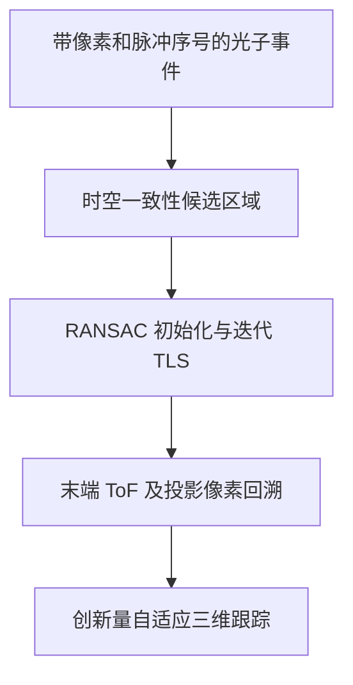

# Instantaneous UAV tracking using single-photon LiDAR via photon-event-driven suppression of temporal-averaging bias

本公开仓库收录原始 PDF，文件内容未修改。原文采用 [CC BY 4.0](https://creativecommons.org/licenses/by/4.0/)；版权与许可归原作者／出版商。完整作者和出处见下文；[PDF 许可清单](../../PDF_LICENSES.md)。

## 文献信息与版本

- 作者：Dongfang Guo, Jianfeng Sun, Xin Zhou, Chen Shen, Sheng Chen, Sining Li, Yanchen Qu；通讯作者 Xin Zhou。Chen Shen 与 Sheng Chen 是不同作者。
- 正式发表：*Opto-Electronic Technology*, 2(2), 260013, 2026；2026-06-28 在线发表。[PDF p.2](paper.pdf#page=2)
- DOI：[10.29026/oet.2026.260013](https://doi.org/10.29026/oet.2026.260013)；[官方来源](https://www.oejournal.org/article/doi/10.29026/oet.2026.260013)。
- 文件：[原始 PDF](paper.pdf) · [BibTeX](citation.bib)。上传为 28 页文件：PDF p.1 为出版商封面，正文 27 页从 PDF p.2 开始。**以下全部引用 PDF 页码，等于正文页码加 1**。
- 期刊全文，非预印本；原文 CC BY 4.0 许可见 [PDF p.28](paper.pdf#page=28)。封面“相关论文”不属于本文。

## 摘要（整理者归纳）

P3DTT（Photon-Aware Three-Dimensional Dynamic Tracking）针对累计光子直方图输出平均位置而非瞬时位置的问题，将光子 ToF、像素和脉冲序号保留为事件集合，通过空间／时间一致性选出回波，再以 RANSAC-iTLS 估计采样末端 ToF 与对应像素，最后进行创新量自适应状态跟踪。最低测试光子条件下仿真展示 2 km、188.8 m/s 目标的偏差校正；真实 2.5 km UAV 实验记录低光子数下多种机动轨迹。全文 Table 4 的外场三维 MAE 为 0.4003–0.4375 m，而不是摘要所称所有误差均低于 0.43 m。该文还描述 FPGA／RK3588 实时架构，应与只提供离线视频的研究区分。[PDF pp.2,14–22,25–26](paper.pdf#page=2)

## 背景、不足与贡献

多帧累计提高回波统计量，却把不同瞬时位置混在同一波形和像素中；高速条件下时间平均偏差与稀疏光子相互强化。本文明确建立运动耦合触发模型，利用邻像素、激光脉宽和跨脉冲的物理连贯性筛选事件，然后恢复采样末端测量，配合能容忍观测缺失与机动的状态估计。[PDF pp.3–11](paper.pdf#page=3)

这篇论文与 [5D-MR 笔记](../2026-guo-uav-motion-blur-super-resolution/notes.md) 的共同点是事件级去噪和运动推断；区别是本文重点在时间平均偏差建模、RANSAC-iTLS 末端测量与自适应连续跟踪，不能将两篇实验条件或误差表合并。

## 方法流程与核心公式



**运动平均偏差。** 为简化原文 Eqs.14–17，令 $w_i$ 是对应事件的信号触发权重、 $\mathbf u_i$ 为瞬时投影坐标，则

$$
\hat{\mathbf u}=\frac{\sum_iw_i\mathbf u_i}{\sum_iw_i},\qquad
\mathbf b_{\rm temp}=\hat{\mathbf u}-\mathbf u_0.
$$

这是整理后的离散加权表达；原文还包括 PSF、ToF 与触发概率积分，不能仅凭均匀时间平均代替完整探测模型。[PDF p.6](paper.pdf#page=6)

**阶段 I：物理一致性筛选。** 将离散 ToF 事件表示为 Dirac 密度，近似用高斯回波加均匀背景估计波形中心 $\mu_{ij}$，再定义

```math
C(i,j)=\sum_m\mathbf1\!\left(|t_m^{(i,j)}-\mu_{ij}|\le p_w/2\right).
```

$C$ 是脉宽支撑区内的事件数， $p_w$ 是激光脉宽；空间邻域由最大可行横向位移确定，时间阈值随最大径向速度和采样时长变化，计数阈值依背景估计自适应。示例采用探测器平面 3 像素邻域。[PDF pp.9–10,12](paper.pdf#page=9)

**阶段 II：RANSAC-iTLS。** 在候选集合 $`\mathcal P=\{(f_k,t_k)\}`$ 上拟合 $t=\alpha f+\beta$：

$$
d_k=\frac{|t_k-\alpha f_k-\beta|}{\sqrt{1+\alpha^2}},\qquad
(\hat\alpha,\hat\beta)=\arg\min_{\alpha,\beta}\sum_{k\in\mathcal I^*}
\frac{(t_k-\alpha f_k-\beta)^2}{1+\alpha^2}.
$$

$f$ 是脉冲索引， $t$ 是 ToF， $`\mathcal I^*`$ 为 RANSAC 内点集。每次 TLS 后重评内点；原文给自适应阈值系数 $\kappa\in[2,3]$，或退火收缩因子 $\gamma\in[0.8,0.95]$。式子保留原文坐标写法，实际实现需明确索引与 ns 的尺度归一化及脉冲周期，不能从混合单位坐标直接推得物理距离。[PDF p.10, Eqs.24–28](paper.pdf#page=10)

末端 ToF 为 $\hat t_{\rm end}=\hat\alpha f_{\rm end}+\hat\beta$，同时通过末端内点对应像素确定瞬时投影；绝对距离还需加 gate／系统时间偏置再按 $c/2$ 换算。这与选择最亮像素或平均 ToF 有本质不同。[PDF pp.14–15,22](paper.pdf#page=14)

**阶段 III：自适应状态估计。** 将转弯加速度分配到三个主平面，状态包含位置和速度；依据各轴实际与预测 innovation 方差比 $\eta_i$ 调整过程协方差 $Q_i$，置信界为 $\tau_i=\bar\eta_i+\lambda\mathrm{std}(\eta_i)$。原文 Eq.30 规定大创新增大 $Q_i$、低创新降低 $Q_i$；未提供所有增益、边界与初始化值，不能据此自行补造完整实现。[PDF pp.10–11](paper.pdf#page=10)

## 单光子 LiDAR 参数与证据类型

| 参数 | 仿真 | 真实外场／部署 | 证据 |
|---|---|---|---|
| 探测器与阵列 | Gm-APD 统计模型， $64\times64$ | 自研 $64\times64$ Gm-APD | [pp.11,21](paper.pdf#page=11) |
| 波长／重复率 | 1064 nm／2.5 kHz | 1064 nm／2.5 kHz | [pp.11,21](paper.pdf#page=11) |
| 激光脉宽／时间 bin／gate | 20 ns／1 ns／1 μs；gate time 13.33 μs | 正文称共享核心参数；部分实测 ToF 图至 2000 ns，具体实测 gate 宽需核实 | [pp.11,22](paper.pdf#page=11) |
| FoV／像素覆盖 | $1^\circ\times1^\circ$，约 0.0156°/pixel；2 km 处约 0.54 m/pixel | 同 FoV；按几何在 2.5 km 约 0.68 m/pixel（整理者换算） | [pp.11,21](paper.pdf#page=11) |
| 信号计数与 SNR | 最低测试 0.2184、背景 1.50 photons/pixel；−8.37 dB | frame 111 信号 0.2731，−7.6839 dB；frame 1 信号 0.2821、背景 1.5983，−7.5326 dB | [pp.12,22](paper.pdf#page=12) |
| 常规仿真速度 | 横向 13.6 m/s，径向 30.0 m/s，三维椭圆轨迹 | 不适用 | [p.11](paper.pdf#page=11) |
| 高速边界 | 188.8 m/s = 横向 22.0 + 径向 187.5 m/s 的合速度；提高光子预算后另测约 383.82 m/s | 实际 DJI Phantom 4 横向 5–15 m/s；不能称实测 188.8 m/s | [pp.15–18,21](paper.pdf#page=15) |
| 距离／环境 | 名义 2 km | 最远 2.5 km、高度约 50 m；小雨，12500 lux，能见度约 2.5 km | [pp.11,21](paper.pdf#page=11) |
| 时间窗与输出 | 拟合例子 250 脉冲 = 100 ms（按重复率换算）；KF 基线时间步 0.02 s | conventional matched filtering 250 脉冲/估计，10 Hz；P3DTT 系统位置输出 5 Hz | [pp.14,19,21–22](paper.pdf#page=14) |
| 处理硬件 | 仿真不等同于硬件时延测量 | FPGA SoC FMQL100TAI900 运行阶段 I–II；RK3588 运行轨迹估计；DDR4≥4 GB，eMMC 32 GB | [p.21](paper.pdf#page=21) |
| 距离量化 | 1 ns 对应 $c\Delta t/2\approx0.15$ m；并非激光脉宽对应的分辨能力 | 同样需 IRF 与标定评价 | [p.11](paper.pdf#page=11) |

SNR 使用信号／背景计数比的 dB 表达，与图中“有效检测 SNR”及处理后的峰值显著性不是同一个量。250 帧、10 Hz 与闭环 5 Hz 属不同环节，正文未说明全部排程和端到端延时分布。[PDF pp.8,12,21–22](paper.pdf#page=8)

## 实验对比与主要结果

**ToF 校正例子（普通动态仿真 frame 56）：** 真值 268.71 ns，末端预测 269.04 ns，绝对误差 0.33 ns；传统结果误差 4.71 ns。与此同时拟合点的正交 residual RMSE 为 4.7419 ns。**0.33 ns 是末端估计误差，4.74 ns 是事件拟合残差，不能混为一个指标**；此例也不自动代表所有 188.8 m/s 高速轨迹的误差。[PDF pp.14–15](paper.pdf#page=14)

**三维动态仿真（Table 3）：** 比较 constant-velocity Kalman filter（KF）与多尺度 Lucas–Kanade optical flow（OF）。下表为原文值，三维行是 MAE，不是三维 RMSE。[PDF pp.19–20](paper.pdf#page=19)

| 指标 | P3DTT (m) | KF (m) | OF (m) |
|---|---:|---:|---:|
| depth MAE | 0.1554 | 0.4130 | 0.6616 |
| depth RMSE | 0.1936 | 0.5146 | 0.8040 |
| row RMSE | 0.0302 | 0.0624 | 0.0622 |
| column RMSE | 0.0312 | 0.0710 | 0.0796 |
| 3D MAE | 0.1652 | 0.4324 | 1.1460 |

**真实 UAV 外场（Table 4）：** 除 KF、OF，还对比 MHT 和 GM-PHD。[PDF pp.25–26](paper.pdf#page=25)

| 轨迹／指标 | P3DTT (m) | KF | OF | MHT | GM-PHD |
|---|---:|---:|---:|---:|---:|
| 圆形巡航：3D MAE | 0.4003 | 2.1571 | 3.4263 | 1.2555 | 0.9866 |
| 边界巡航：3D MAE | 0.4375 | 0.7759 | 0.9615 | 0.7812 | 0.9221 |
| 圆形巡航：depth RMSE | 0.4855 | 5.1578 | 4.3782 | 2.0659 | 1.1715 |
| 边界巡航：depth RMSE | 0.5209 | 0.6523 | 0.6972 | 0.9281 | 1.0958 |

P3DTT 横向 row RMSE 为 0.0743／0.0698 m，column RMSE 为 0.0729／0.0901 m。原文 p.23 明确采用机载 RTK 的飞行距离作为纵向真值；全三维参考坐标、横向真值来源、时间同步精度未完整展开，结果须在该验证说明下解读。[PDF pp.23,26](paper.pdf#page=23)

## 消融、局限与需核实之处

- 原文有阶段输出、不同速度／光子预算扫描、RANSAC-iTLS 迭代统计及多基线对比；未提供“去掉每个模块”形式的完整数值消融矩阵。[PDF pp.12–20](paper.pdf#page=12)
- 作者将工作边界归因于采样窗内可用光子预算与运动导致的时空相干性丧失；后续拟采用自适应脉冲能量和更大接收口径，在散射环境中扩展高速边界。[PDF pp.25,27](paper.pdf#page=25)
- 整理者判断：近线性 ToF 拟合、物理阈值和单目标候选关联仍有假设；尚无公开数据／代码支撑全面复现，多目标交叉与强非均匀背景的适用性未被本文完整验证。
- 原文摘要“误差低于 0.43 m”与 Table 4 的 0.4375 m 不符；对 KF 改善“81%–88%”也不能涵盖边界巡航：由该表计算，0.4375 对 0.7759 的下降约 **43.6%**，圆形巡航约 **81.4%**。这些是整理者对表格的核算。[PDF pp.2,25–26](paper.pdf#page=2)
- p.7 给单像素角度 0.156°，p.11 给 0.0156°，后者符合 $1^\circ/64$。p.18 图注 383.92 m/s 与正文 383.82 m/s 不一致；p.19 给模型 $y=1.006883x+311.578191$、 $x=250$，却预测 5633.30 ns，直接计算约 563.30 ns，应向作者核实。[PDF pp.7,11,18–19](paper.pdf#page=7)

## 官方代码、数据与复现信息

上传全文未提供官方代码仓库、原始外场数据、权重／固件或独立 Data Availability 下载入口。复现需要原始事件、光学与时钟标定、RTK／LiDAR 同步、各阈值与协方差初始化、状态更新排程和 FPGA／NPU 实现。已给型号与工作节奏不等于提供端到端延时、吞吐或资源占用表；可记录为作者报告的部署，不能视为本仓库已复现。[PDF pp.9–11,19,21,27–28](paper.pdf#page=9)

## 阅读总结（整理者归纳）

本文最可借鉴的是显式定义“测量对应哪个时刻”，并让光子事件分割、末端时间回归和跟踪器使用一致参考时刻。对后续研究，应分别报告事件残差、末端 ToF 误差、方向 RMSE、三维 MAE 和闭环延迟，同时提供完整外部三维真值，才能判断偏差校正与状态预测各自的贡献。
