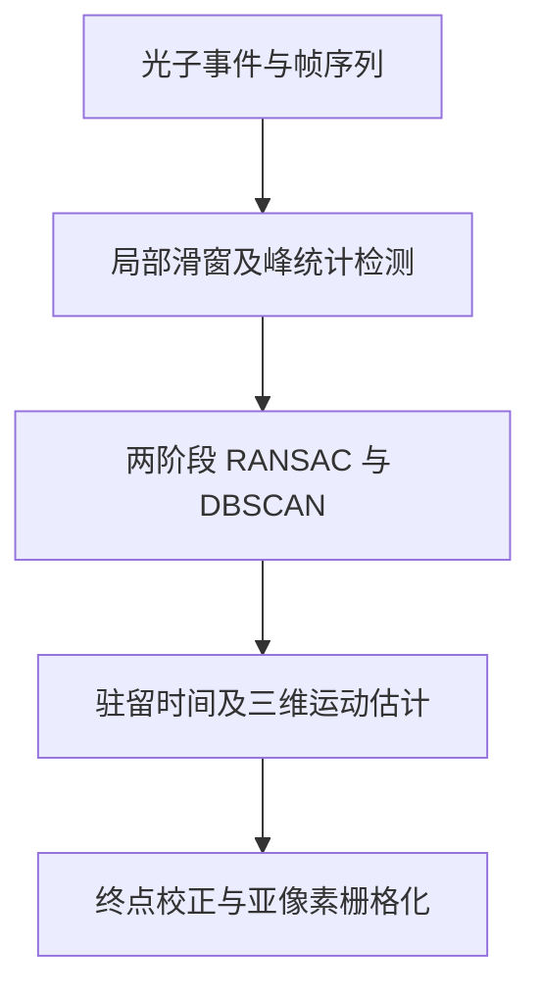

# Dynamic motion-blur suppression and super-resolution localization of UAV targets using single-photon LiDAR under ultra-low SNR

本公开仓库收录原始 PDF，文件内容未修改。© 2026 Optica Publishing Group。按 [Optica OAPA](https://opg.optica.org/content/author/portal/item/review-copyright-permissions/) 用于非商业文献学习及再分发；保留署名、题名、期刊、DOI 和原版权声明，其他权利由权利人保留。完整作者和出处见下文；[PDF 许可清单](../../PDF_LICENSES.md)。

## 文献信息

- 作者：Dongfang Guo, Xin Zhou, Jianfeng Sun, Sheng Chen, Yinbo Zhang, Sining Li, Yanchen Qu；通讯作者 Jianfeng Sun。
- 正式发表：*Optica*, 13(3), 491–510, 2026；2026-03-10 发表。上传为 20 页期刊全文。[PDF p.1](paper.pdf#page=1)
- DOI：[10.1364/OPTICA.581370](https://doi.org/10.1364/OPTICA.581370)；[官方来源](https://opg.optica.org/optica/abstract.cfm?uri=optica-13-3-491)。
- 文件：[原始 PDF](paper.pdf) · [BibTeX](citation.bib)。页码按 PDF 文件计数，p.1 对应期刊 p.491。
- PDF 第 1 页标注 Optica Open Access Publishing Agreement；已核对出版商现行政策，允许非商业用途再分发并保留适当署名。[PDF p.1](paper.pdf#page=1)

## 摘要（整理者归纳）

论文面向远距离、亚像素 UAV 的光子稀缺运动检测，提出 Five-Dimensional Motion-Aware Reconstruction（5D-MR）。局部窗口汇聚光子，以峰宽与峭度筛选目标；随后两阶段 RANSAC 与 DBSCAN 联合提取回波，利用像素驻留／重叠时间推断速度和尺寸，将结果校正到采样结束位置并栅格化为亚像素定位。仿真在 SNR −9.03 dB、信号均值 0.5343 photons/pixel 下给出小于 0.5 m 的距离误差；1.8 km UAV 外场在 SNR −8.97 dB、0.3550 photons/pixel 下验证运动模糊抑制。角度精度、尺寸误差及速度参数在原文部分位置存在不一致，下文逐项注明，不将网格细化倍数当作独立测量精度。[PDF pp.2,7–19](paper.pdf#page=2)

## 研究背景、不足与贡献

长时间累计使目标光子在多个像素与时间 bin 间扩散；MLE、matched filter 和 KDE 输出易成为模糊轨迹或平均位置。原始阵列像素尺度还限制远距离小目标定位。本文把 ToF、行、列、光子统计和帧序列联合建模，以跨帧连贯性识别低 SNR 回波，并把横向运动当作自然扫描来辅助亚像素估计。[PDF pp.2–4](paper.pdf#page=2)

方法不需要训练神经网络，但仍需要滑窗大小、峰宽、阈值、RANSAC 约束与 DBSCAN 参数；原文“parameter-free”主要指没有可学习权重，不宜解释为没有算法参数。[PDF pp.5–8,14](paper.pdf#page=5)

## 方法、模块与公式

**光子模型与 SNR。** 原文以信号和背景光子均值定义

$$
\mathrm{SNR}=10\log_{10}\!\left(\frac{N_s}{N_n}\right).
$$

$N_s$、$N_n$ 为所用统计条件下的平均信号、背景计数；不能将这个 dB 数值直接和其他论文的无量纲 SBR 对比。Geiger 触发概率还考虑 speckle／强度波动参数 $M'$。[PDF pp.2–3, Eqs.2–7](paper.pdf#page=2)

**候选区域。** 在 $W_s\times W_s$ 窗口统计 ToF 直方图，以峰宽和峭度选择窗口，再以峰内光子比例阈值 $\gamma$ 标记目标像素。正文示例最大峰宽为 100 bins（约 15 m 的深度范围）。[PDF pp.4–5](paper.pdf#page=4)

**时间趋势与事件分割。**

$$
t_i=ai+b+\epsilon_i,\qquad \epsilon_i\sim\mathcal N(0,\sigma^2).
$$

$i$ 为事件所属脉冲／子帧序号，$t_i$ 是 ToF；$a$、$b$ 为拟合斜率和截距。两次 RANSAC 去除离群点并细化拟合，斜率受物理速度约束，截距与残差受激光脉宽、计时抖动约束。DBSCAN 在时间–帧域识别主簇及有效起止帧，不是另设固定子帧阈值。[PDF pp.5–6](paper.pdf#page=5)

**速度、终点距离和尺寸。** 统一符号后的整理表达：

$$
L_{\rm pixel}=R\tan(\theta/M),\quad
v_r=\frac{mL_{\rm pixel}}{\Delta t_r},\quad
v_c=\frac{nL_{\rm pixel}}{\Delta t_c},\quad
v_z=\frac{c}{2}\frac{a}{T_{\rm frame}},
$$

$$
\hat t_{\rm end}=aF_{\rm res}+b,\qquad
\hat R_{\rm end}=\frac c2(\hat t_{\rm end}+t_0),\qquad
W=v_c t_1,\quad L=v_r t_2.
$$

$\theta$ 为总 FoV 角宽，$M$ 为单边阵列像素数，$R$ 为距离；$m,n$ 为跨越像素数；$\Delta t_r,\Delta t_c$ 为对应驻留时长；$T_{\rm frame}$ 为模型中事件帧周期；$F_{\rm res}$ 为重建终帧；$t_0$ 为系统延时；$t_1,t_2$ 为邻像素同时出现回波的时长。使用斜率时必须核对帧索引实际对应的脉冲周期，不能误用 5 Hz 重建周期。[PDF pp.6–7, Eqs.17–25](paper.pdf#page=6)

终像素内位移 $\delta x=v_c\Delta t^*$、$\delta y=v_r\Delta t^*$ 与估计尺寸共同确定栅格化，示意中每像素细分 $10\times10$。这属于输出坐标表达；最终定位精度仍受光子、标定和运动估计限制。[PDF p.7](paper.pdf#page=7)

## 关键参数与实验条件

| 参数 | Monte Carlo 仿真 | 真实 UAV 外场 | PDF 证据 |
|---|---|---|---|
| 探测器／阵列 | Gm-APD 模型，$64\times64$ | $64\times64$ Gm-APD | [pp.8,14](paper.pdf#page=8) |
| 波长／重复率 | 1064 nm／2.5 kHz | 1064 nm／2.5 kHz | [pp.8,14](paper.pdf#page=8) |
| 脉宽／功率／口径 | 脉宽等具体值未见 Table 3 | 10 ns／6.8 W（2.72 mJ/pulse）／800 mm | [p.14](paper.pdf#page=14) |
| FoV／距离 | $1^\circ\times1^\circ$／约 1 km | 同 FoV／1.8 km 斜距，约 45 m 高度 | [pp.8,14](paper.pdf#page=8) |
| gate／时间 bin | 1000 ns／1 ns | 2000 ns／1 ns | [pp.8,14](paper.pdf#page=8) |
| 采样／重建节奏 | 500 脉冲帧累计，5 Hz（按 2.5 kHz 对应 0.2 s） | 同样累计 500 帧，有效 5 Hz | [pp.9,15](paper.pdf#page=9) |
| 信号计数／SNR | 0.5343 photons/pixel；最低测试 −9.03 dB | 信号 0.3550、背景 2.7977 photons/pixel；−8.97 dB | [pp.8,15](paper.pdf#page=8) |
| 速度 | 引言给横向约 4 m/s、纵向 7 m/s；正文输入为两横向分量 15 pixels/s、纵向 7 m/s；具体像素–米换算有不一致，见下文 | 设置横向约 12 m/s、longitudinal 约 5 m/s；估计 11.34／4.62 m/s | [pp.2,8,14–15](paper.pdf#page=2) |
| 目标尺寸 | 0.5 pixel，反射率 0.3 | DJI Phantom 4，289.5×289.5×180 mm | [pp.8,14](paper.pdf#page=8) |
| 原生横向像素覆盖 | p.11 给约 0.273 m/pixel | 约 0.490 m/pixel | [pp.11,15](paper.pdf#page=11) |
| 滑窗／算力 | 示例 $4\times4$；估算约 0.09 GFLOPs/重建帧 | 未提供可核对的端到端实测延时 | [pp.8,13–14,19](paper.pdf#page=8) |

以上 photons/pixel 使用原文口径；没有足够信息把它统一换成所有像素的累计检测 PPP，也不把信号均值和 gate 全背景计数混为一项。

## 对比与主要定量结果

- MLE、matched filter、KDE 在 6.99、−3.01、−9.03 dB 仿真中比较；5D-MR 可在最低测试条件提取候选目标，常规方法在文中条件下退化。[PDF pp.9–10](paper.pdf#page=9)
- Table 5 八次重建：MLE 的平均有符号距离误差为 −6.672 m、标准差 3.178 m；5D-MR 为 +0.202 m、0.211 m。5D-MR 逐次误差为 0.430、0.124、0.241、0.478、0.357、−0.004、−0.113、0.106 m。这是距离误差，不是三维轨迹 RMSE。[PDF pp.12–13](paper.pdf#page=12)
- 横向仿真在 p.12 描述重建精度优于 0.1 pixel；摘要描述实际 UAV 角度精度优于 0.01°、尺寸误差低于 0.02 m。结论却分别写仿真 0.1°、外场 0.01 pixel；单位存在矛盾，不能合并为统一精度值。[PDF pp.1–2,12,18–19](paper.pdf#page=1)
- 外场估计二维尺寸约 0.272×0.214 m，并通过同轴 3840×2160 相机作定位参照，相机 FoV 为 4.06°×2.29°、角分辨率 0.001058°/pixel。实际尺寸、投影方向与误差统计口径未完全统一，因此“全部尺寸误差 <0.02 m”仅记为作者声明，不能从三维外形尺寸直接推出。[PDF pp.14–19](paper.pdf#page=14)
- 与典型神经网络约 2.5 GFLOPs 的比较是操作量估计，约 27 倍的比值不等于同硬件实测推理加速；正文结尾明确计算负载仍可能需要硬件加速。[PDF pp.13–14,19](paper.pdf#page=13)

## 消融、适用条件与原文不一致

原文展示阶段性去噪／拟合图和不同 SNR、线性／曲线路径结果，但未提供完整的逐模块数值消融表。[PDF pp.9–13](paper.pdf#page=9)

**作者明确限制与后续工作：** 需要跨像素运动，典型最低速度约 1–2 m/s；不适合静止或悬停。窗口内近线性拟合对突然机动、大曲率运动易退化；交叉多目标可能发生轨迹混叠；标定、时钟和强背景限制性能。后续包括自适应 gating 与参数调节、光学／雷达融合、多目标和大范围监测。[PDF pp.7,19](paper.pdf#page=7)

**需核实的原文细节：**

- p.8 在 1 km 给约 0.55 m/pixel，但 p.11–12 给 0.273 m/pixel；$1^\circ/64$ 的几何换算支持后者。不要将两者混用推导速度上限。[PDF pp.8,11–12](paper.pdf#page=8)
- Eq.27 的速度数值写为 “3.362 s”，量纲不正确；Table 7 的部分起止帧和 Frame Span 算术不符，例如 283–470 对应 188 帧而表写 168。精确驻留时间及尺寸复算需作者核对。[PDF pp.11,15](paper.pdf#page=11)
- 文中 longitudinal 同时用于 ToF 距离运动和 FoV 平面方向描述；此处保留原词，避免把 p.15 的 4.62 m/s 自动解释成径向速度。

## 官方代码、数据与复现

- 官方代码链接：上传全文未提供。没有据本文实现并验证的代码仓库。
- 数据未公开，可向作者合理申请；不是直接下载数据。[PDF p.19](paper.pdf#page=19)
- 复现需光子 ToF、像素位置、脉冲／帧索引、系统延时与内外参，而不仅是最终强度图；RANSAC 迭代数、minPts、像素阈值等完整配置未全部给出数值。
- 5 Hz 是采样累计后重建序列的有效节奏，正文未给同硬件端到端实时处理测试，不能因此宣称已实现 5 Hz 在线流水线。

## 阅读总结（整理者归纳）

本文值得借鉴的核心是用低层光子事件的时序、驻留和邻像素重叠恢复“采样结束位置”，而不是只对模糊图像做插值。对运动小目标有用，但严格依赖跨像素观测和可辨认的局部运动趋势。设计后续实验时，应把终点参考时刻、角度误差单位、投影尺寸定义和实际处理延时同时记录。
