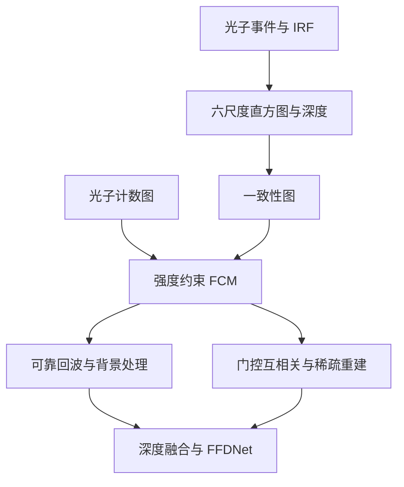

# Multi-Temporal Resolution-Guided 3-D Imaging for Array-Based Single-Photon LiDAR

本公开仓库收录原始 PDF，文件内容未修改。原文采用 [CC BY 4.0](https://creativecommons.org/licenses/by/4.0/)；版权与许可归原作者／出版商。完整作者和出处见下文；[PDF 许可清单](../../PDF_LICENSES.md)。

## 文献信息

| 字段 | 内容 |
|---|---|
| 作者 | Kai Qiao; Yu Chang; Zefang Xu; Fei Yin; Chang Su; Liyu Liu; Tianye Liu; Chunliang Liu; Jinshou Tian; Xing Wang |
| 作者说明 | Kai Qiao 与 Yu Chang 为共同第一作者；Xing Wang 为通讯作者 |
| 出版 | *IEEE Photonics Journal*, 18(1), 7800108, pp.1–8, 2026 |
| 版本 | 正式发表版本；2025-12-18 在线发表，期刊卷期为 2026-02；上传 PDF 共 8 页 |
| DOI | [10.1109/JPHOT.2025.3645783](https://doi.org/10.1109/JPHOT.2025.3645783) |
| 官方来源 | [IEEE Xplore](https://ieeexplore.ieee.org/document/11303763/) |
| 文件 | [原始 PDF](paper.pdf) · [BibTeX](citation.bib) · [仓库总览](../../README.md) |
| 论文许可 | CC BY 4.0；不改变原论文的归属和许可 |

依据上传全文整理；所有页码为 PDF 页码。书目信息及许可见 [PDF p.1](paper.pdf#page=1)。目录年份采用正式卷期年份，而非首次在线年份。

## 摘要与研究问题

**原文：** 远距离面阵单光子 LiDAR 的不同像素具有不同回波强度、噪声和回波展宽，统一算法容易丢失局部结构。本文构造 1–32 ns 多时间分辨率直方图，以各尺度深度估计的一致性和光子计数进行 FCM 分割，再对不同像素匹配不同重建方法，并用 FFDNet 平滑输出。[PDF pp.2–5](paper.pdf#page=2)

实测系统在 4 km 行人、10 km 电塔和 10 km 转动风机场景中验证，风机视频以 20 ms 的光子累积窗口进行离线重建，形成 50 fps 的深度视频。[PDF pp.6–8](paper.pdf#page=6)

**整理者归纳：** 本文“多时间分辨率”主要指同一时间窗口数据的不同 ToF bin 宽度，不是使用多种视频采样帧率；“动态算法匹配”指按像素类型选择算法，不等同于显式运动补偿。

## 背景、不足与贡献

- 面阵不同像素 SBR 不一致，回波展宽会使信号跨越多个 bin；粗 bin 有助于聚集信号，却牺牲距离精度且增加背景量。[PDF p.3](paper.pdf#page=3)
- 使用多尺度深度一致性而非只用单尺度峰值做像素分类，结合强度约束的 fuzzy c-means（FCM）。[PDF pp.3–4](paper.pdf#page=3)
- 为可靠、无回波、可门控的弱回波和更稀疏的像素分别使用峰值检测、常数赋值、门控互相关及 TV/DCT 正则重建。[PDF pp.4–5](paper.pdf#page=4)
- 配合 1550 nm、64 × 64 InGaAs/InP SPAD 面阵系统，在短累积窗口内保留公里级远距离目标结构。[PDF pp.2、6–7](paper.pdf#page=2)

## 方法与核心公式

### 1. 多尺度直方图和深度图

从 1 ns 原始直方图开始，将相邻 bin 分别按 2、4、8、16、32 合并，生成六个时间尺度。各尺度与 IRF 互相关后取峰值得到 $D_1,\ldots,D_6$； $D_6$ 对应最粗 32 ns 尺度。[PDF p.3，式 (1)–(4)](paper.pdf#page=3)

物理 ToF 到距离的换算可写为 $`d=c\,t_{\rm ToF}/2`$。这里是**整理者的单位说明**：在实现中若峰值位置是 bin 索引，须乘该尺度 bin 宽度并处理门起点与 IRF 偏移，不能将索引直接当作时间。

### 2. 尺度一致性和 FCM

原文式 (5) 的一致性指标为：[PDF p.4](paper.pdf#page=4)

$$
C(j,k)=\left(\frac{1}{5}\sum_{i=1}^{5}|D_6(j,k)-D_i(j,k)|\right)^{-1}.
$$

不同尺度深度接近时 $C$ 较大。原文未在该式中写出零分母处理；复现时若加入 $\epsilon$ 应注明为实现补充。

FCM 优化目标，原文式 (6)：

$$
\min_{U,V}\sum_{i=1}^{MN}\sum_{j=1}^{c}u_{ij}^{m}\lVert X_i-v_j\rVert_2^2,
\qquad u_{ij}\ge0,\quad\sum_{j=1}^{c}u_{ij}=1.
$$

$X_i$ 为一致性图的像素样本， $v_j$ 为簇中心， $u_{ij}$ 为隶属度， $m$ 为模糊指数；此式中的 $c$ 为簇数，与 ToF 换算中的光速符号含义不同。再通过归一化光子计数 $f(G_i)=G_i/\max(G)$ 修正隶属度并归一化，迭代至变化小于阈值。[PDF p.4，式 (7)–(8)](paper.pdf#page=4)

### 3. 分支重建与融合

| 像素类别 | 重建策略 | 原文位置 |
|---|---|---|
| 各尺度深度稳定、信号较强 | 峰值检测 | PDF p.4 |
| 无可靠回波 | 常数深度标记 | PDF p.4 |
| 可用粗尺度深度引导的弱信号 | 在 $[D_6-\tau/2,D_6+\tau/2]$ 内互相关 | PDF p.4 |
| 更稀疏或缺损的像素 | TV 与 DCT 稀疏正则，ADMM 求解 | PDF pp.4–5 |

各分支按像素位置融合，最后用 FFDNet 去噪。算法中的 FCM 属无监督聚类；包含 FFDNet 并不意味着整套算法是端到端训练的深度网络。

## 系统及实验参数

| 项目 | 原文报告 | 依据 |
|---|---|---|
| 探测器 | 64 × 64 InGaAs/InP SPAD，面阵有效面积 3.2 × 3.2 mm² | PDF p.2 |
| 激光 | 1550 nm、脉宽 1 ns、25 kHz，最大平均功率 1.25 W | PDF p.2 |
| 光学系统 | 双站收发；接收口径 300 mm，焦距 3000 mm | PDF p.2 |
| 视场与角分辨率 | 1.2 mrad，20 µrad；10 km 对应约 0.20 m 横向尺寸 | PDF pp.2、6–7 |
| 时间 bin | 原始 1 ns，合并到 2/4/8/16/32 ns | PDF p.3 |
| 仿真 | Art、Bowling；PPP 1.0、2.0，SBR 0.2；100 次激光照射，单像素探测窗口 2000 ns | PDF p.5 |
| 实测参考图 | 长时间采集后的 MLE 重建作为参考，不能视作独立计量真值 | PDF p.6 |
| 目标速度 | 风机转动速度未定量报告 | PDF p.7 |

## 定量结果

| 场景 | 条件及处理方式 | 主要结果 | 依据 |
|---|---|---|---|
| 仿真 Art/Bowling | PPP 1/2，SBR 0.2 | 图 4(a) 指定条件下，相对 Rapp、Li 的 RMSE 分别降低 41.6%、78.1%；不能泛化为所有场景平均 | PDF pp.5–6 |
| 4 km 行人与建筑 | 20 ms、500 二值帧；全场平均 PPP 6.60，SBR 0.26；图 5(a) 参考采集 0.8 s | 相对 MLE、Rapp、Li，PSNR 分别提升 10.59、5.13、3.03 dB | PDF p.6，图5 |
| 10 km 电塔 | 20 ms；PPP 2.0，SBR 0.28；参考采集 5.0 s | 相对 MLE、Rapp、Li，PSNR 分别提升 15.88、10.48、4.59 dB | PDF p.7，图6 |
| 10 km 转动风机 | 共采集 0.8 s、20,000 二值帧；每次合并 500 帧、20 ms；PPP 1.7，SBR 0.4 | 离线重建形成最高 50 fps 的深度视频 | PDF p.7，图7 |

**口径提醒：** 摘要写动态帧率“超过 50 fps”，实验与结论写“最高 50 fps”，本笔记采用 20 ms 窗口所支持的 50 fps。全文未报告算法实际运行时间，不能称为已实现端到端实时 50 fps。[PDF pp.1、7–8](paper.pdf#page=1)

## 消融、局限性与后续工作

**原文：** 图 3 比较峰值检测、互相关、RDI-TV、分割后算法匹配，以及进一步加入 FFDNet 的效果。分割和算法匹配保留轮廓，FFDNet 进一步抑制噪声。[PDF p.5](paper.pdf#page=5)

**整理者归纳：** 方法依赖多尺度一致性能够区分真实结构与背景；门宽、FCM 参数、分支阈值和 FFDNet 配置仍需充分记录。细尺度和粗尺度距离应统一单位；系统分辨率、输出图像尺寸与重建误差不是同一指标。

**原文存在的表述差异：** 4 km 段落写空间分辨率约 20 cm，而固定 20 µrad 对应的几何横向尺度约为 8 cm；10 km 时约 20 cm 与该角分辨率一致。图 7(a) 附近还出现“pylon”的文字，但本节及图示讨论的是 wind turbine。以上保留为待核实项，不自行修改原文事实。[PDF pp.6–7](paper.pdf#page=6)

**作者后续工作：** 文中强调对远距离、真正实时 3-D 成像的潜力，但未给出详细实时化实施方案。[PDF pp.2、7–8](paper.pdf#page=2)

## 代码、数据与复现

- 官方代码和完整实测数据下载地址：上传全文未提供。
- 可复现要素：原始二值帧/ToF 数据、IRF、时间门定义、六尺度直方图、FCM 模糊指数与停止阈值、强度权重、像素分支阈值、TV/DCT 权重、ADMM 迭代设置及 FFDNet 配置。
- 应分别报告 20 ms 累积时间、离线算法耗时和视频输出速率；保持与 MLE/Rapp/Li 的输入、参考图和评价掩膜一致。

## 阅读总结

**整理者归纳：** 可借鉴的是利用尺度稳定性评估单像素可信度，再匹配适合的重建器。它适合与显式运动建模或深度重建方法结合，但本文证据主要是短窗口离线远距离重建，没有证明对高速平移 UAV 的瞬时无偏追踪能力。
