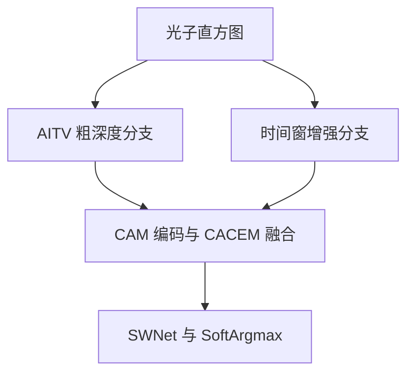

# Physics enhanced single-photon imaging based on deep learning

本公开仓库仅提供依据正式全文整理的笔记和引用；PDF 不在仓库内。[全文获取、版权原因与原始 PDF 页码说明](source.md)。文中 PDF 页码均沿用用户实际上传的文件页码。

## 文献信息

- 作者：Haoran Shen, Jian Li, Ruiyi Zheng, Lu Cao, Qin Wang；Haoran Shen、Jian Li 共同第一作者，Qin Wang 通讯作者。
- 正式发表：*Photonics Research*, 14(9), 4117–4130, 2026；2026-08-28 发表，归入 2026 年 9 月卷期。上传为 14 页期刊全文。[PDF p.1](source.md#pdf-page-1)
- DOI：[10.1364/PRJ.601600](https://doi.org/10.1364/PRJ.601600)；[官方来源](https://opg.optica.org/prj/abstract.cfm?uri=prj-14-9-4117)。
- 文件：[全文获取说明](source.md) · [BibTeX](citation.bib)。PDF p.1 对应期刊 p.4117。
- PDF 版权为 Chinese Laser Press；上传全文未给出可确认的 CC 再分发许可，不将它纳入自写文档的许可证。[PDF p.1](source.md#pdf-page-1)

## 摘要（整理者归纳）

论文以显式 AITV（Anisotropic and Isotropic Total Variation）结构先验改善单光子深度网络。AITV 粗深度分支与时间窗光子分支分别编码，再由 CACEM 交叉注意力融合，并交给结合局部 CNN 与全局 Swin Transformer 的 W 形 SWNet。模拟数据支持同协议训练基线下的大部分条件改善；公开实测和实验室 TCSPC 数据主要提供定性结构比较。高分辨率输入的常规推理约 45 s，工程优化后约 16 s，因此这是优先追求重建质量的离线方法。[PDF pp.3–13](source.md#pdf-page-3)

## 背景、现有不足与贡献

纯数据网络对训练分布外的光子预算、背景和几何变化可能不稳；局部卷积容易过平滑，纯全局模型又可能丢失细节。本文将显式正则先验与可学习光子特征融合，并把局部和全局信息分别维护、逐尺度协作。作者强调该模块框架可接其他 backbone，而非仅提出另一个网络。[PDF pp.1–3,6,13](source.md#pdf-page-1)

本文**不是逐层展开完整 ADMM 的 deep unrolling 网络**；原文明确采用 AITV 先验分支再融合，不能因出现 ADMM 推导就将整个 SWNet 称为优化算法展开。[PDF p.3](source.md#pdf-page-3)

## 方法与关键公式

**测量模型。** 以物理时间记号整理为

$$
s_{ij,t}\sim\mathrm{Poisson}\left(\alpha_{ij}h(t-2d_{ij}/c)+b_{ij}\right).
$$

$s$ 为计数， $\alpha$ 为反射／回波幅度， $h$ 为 IRF， $d$ 为距离， $b$ 为时间均匀背景和暗计数；离散实现需以 bin 宽换算时间，并满足重复周期大于最大往返延时。[PDF p.3, Eq.1](source.md#pdf-page-3)

**AITV 先验。** 注意这里是两种 TV 的**差**，而不是简单相加：

$$
J(u)=\sum_{ij}(|D_xu_{ij}|+|D_yu_{ij}|)
-\tau\sum_{ij}\sqrt{(D_xu_{ij})^2+(D_yu_{ij})^2},\quad \tau\in[0,1],
$$

$$
\min_u L(u)+\lambda J(u).
$$

$u$ 是粗深度图， $D_x,D_y$ 为差分， $\lambda$ 为数据项／正则权重， $\tau$ 为两类 TV 的权衡； $L$ 为 Poisson 数据项。原文引入辅助变量并用 ADMM 分解， $u$ 更新走 Fourier 域、数据项更新采用 Newton、梯度项采用 shrinkage，再更新对偶与 penalty；这是预处理先验求解流程。[PDF pp.3–4, Eqs.2–18, Algorithm 1](source.md#pdf-page-3)

原文对线性算子 $A$ 与实际时间平移测量模型的对应、背景项在不同目标式中的保留方式没有完全展开；Eq.16 写的是 practical shrinkage update。复现时需核对实际求解器，不能仅据笔记声称非凸目标已被精确求解。[PDF p.4](source.md#pdf-page-4)

**双分支与融合。** AITV 输出二维深度再上投影至三维；时间窗宽接近脉冲 FWHM，汇聚回波附近的计数。CAM 提取多尺度特征与注意力；CACEM 用一分支查询另一分支：

$$
\mathrm{Attention}(Q,K,V)=\mathrm{softmax}\left(\frac{QK^\top}{\sqrt{d_e}}\right)V.
$$

$Q,K,V$ 为窗口内嵌入， $d_e$ 为 embedding 维度；再以 ECA 全局通道权重补充，形成残差融合。[PDF pp.3,5](source.md#pdf-page-3)

**SWNet 与训练目标。** 两套串联 encoder–decoder 组成 W 形路径；各尺度分别处理 CNN 局部细节与 shifted-window Swin 全局信息。预测归一化时间概率 $\hat h$，以 SoftArgmax 估计 bin，再转换距离：

$$
S(\hat h_{ij})=\sum_n n\hat h_{ij}[n],\qquad
\mathcal L=\sum_{ij}D_{\rm KL}(h_{ij}\Vert\hat h_{ij})+10^{-5}\mathrm{TV}(S(\hat h)).
$$

$h$ 为真实归一化直方图；这里训练 loss 的 TV 与预处理 AITV 是不同位置的约束，两个 $\lambda$ 不应混用。[PDF pp.6–7](source.md#pdf-page-6)

## 实验条件与关键参数

| 证据类型 | 探测器／空间规模 | 时间与光子条件 | 距离、速度与可验证范围 |
|---|---|---|---|
| 模拟训练／测试 | NYUv2 训练、Middlebury 测试； $64\times64$ 数据、 $32\times32$ crop，不等于硬件阵列 | 1024 bins，80 ps/bin，400 ps FWHM；九组混合信号:背景计数训练，18 组测试 | 无独立公里级外场或 UAV 速度验证；80 ps 换算约 12 mm 距离 bin，不能当作误差 |
| Lindell 公开实测 | LinoSPAD 一维阵列配合扫描， $256\times256\times1536$ 重建体；PointGrey 相机仅作结构参照 | 450 nm 激光；26 ps/bin；原采集系统扫描率 20 或 5 Hz | 本文五场景定性评价，无完整逐像素 metric depth 真值，不报告其量化 RMSE |
| 本文实验室 TCSPC | 单 SPAD 模块配双轴扫描， $128\times128$ 扫描网格；不是 $128\times128$ 硬件阵列 | 830 nm，10 MHz，激光 FWHM 70 ps；PicoHarp 300，4 ps/bin；实测 IRF FWHM≈340 ps | 室内平面、锥柱、球、石膏头像；绝对距离、目标速度、每点驻留／总采集时间原文未提供 |

来源：[PDF pp.6–11](source.md#pdf-page-6)。实验室条件 PPP=3、SBR≈2 与 PPP=11、SBR≈0.5；PPP 是**平均检测光子数**，不是平均信号光子数。第二组检测光子更多但背景也更强，不能只按 PPP 判定条件更好。[PDF pp.10–12](source.md#pdf-page-10)

训练样本共 16000，train/validation=13000/3000；Adam，batch=4，12 epochs，学习率 cosine annealing 从 $10^{-3}$ 到 $10^{-6}$。设备为双 RTX 5090 与 i9-14900KF。学习基线分别训练三次，选各次最佳 validation checkpoint，报告均值±标准差。[PDF pp.6–7](source.md#pdf-page-6)

## 对比方法、评价指标与定量结果

量化指标为 depth RMSE (m)、相对误差小于 1% 的 Accuracy、SSIM。学习基线包括 U-Net、NonLocal、PRS-Net；经典方法表中单次结果来自原结果，其他未公开训练／评估代码的方法未混入同协议量化比较。[PDF pp.7–8](source.md#pdf-page-7)

| 信号:背景条件 | U-Net RMSE (m) | NonLocal | PRS-Net | 本文 | 本文 Accuracy (%) |
|---|---:|---:|---:|---:|---:|
| 10:2 | 0.0133±0.0080 | 0.0088±0.0005 | 0.0090±0.0005 | 0.0070±0.0018 | 99.42±0.19 |
| 2:10 | 0.0380±0.0567 | 0.0130±0.0044 | 0.0125±0.0035 | 0.0123±0.0054 | 97.59±0.59 |
| 2:50 | 0.0187±0.0103 | 0.0152±0.0060 | 0.0148±0.0051 | 0.0179±0.0173 | 96.48±1.04 |
| 50:20 | 0.0087±0.0003 | 0.0076±0.0002 | 0.0088±0.0002 | 0.0060±0.0007 | 99.72±0.13 |
| 30:12 | 0.0093±0.0006 | 0.0080±0.0003 | 0.0087±0.0003 | 0.0059±0.0008 | 99.72±0.10 |

来源：原文 Tables 1–2，[PDF pp.7–8](source.md#pdf-page-7)。本文在 2:50 的 RMSE 和部分条件的 SSIM 并非最好；不能写“全部噪声条件全面优于基线”。真实公开测量与实验室数据没有完整稠密深度真值，因此定性比较不应被外推为毫米级实测精度。[PDF pp.9–10](source.md#pdf-page-9)

## 消融、计算开销与局限

| 2:2 条件消融 | RMSE (m) | 说明 |
|---|---:|---|
| 全模型 | 0.0111±0.0037 | AITV+CAM+CACEM+SWNet |
| 去 AITV | 0.0185±0.0222 | 不用显式先验分支 |
| 去 CACEM | 0.1419±0.1286 | 用 concatenation+1×1×1 conv 替代融合 |
| 去 CAM | 0.0219±0.0313 | 去前端特征注意力 |
| Mamba 全局分支 | 0.0197±0.0235 | 替换 Swin |
| U-Net backbone | 0.0141±0.0093 | 替换 SWNet |

来源：[PDF pp.11–12, Table 4](source.md#pdf-page-11)。该条件下移除融合模块损失最大；这支持模块协作的重要性，但不是所有输入条件的通用效应大小。

高分辨率 $576\times704$ 输入：5.08 M 参数、100.6 GFLOPs、峰值显存 2.27 GB、常规滑窗推理 45 s；PRS-Net 为 14 s、NonLocal 为 15 s、U-Net 为 60 s。额外 batch 滑窗、双 GPU patch 并行与 TF32 优化可降到约 16 s。以上是**离线推理时间**，不等于激光扫描率，更不能据 5／20 Hz 原采集系统帧率声称本文网络实时运行。[PDF pp.12–13, Table 5](source.md#pdf-page-12)

作者明确指出参数量与中间特征内存影响受限设备部署；后续包括减少 feature channel、mixed/half precision、稀疏卷积、轻量 backbone、pruning、硬件适配。[PDF p.13](source.md#pdf-page-13)

整理者判断：时间均匀背景、模拟 IRF 与近似单深度表示仍是方法条件；AITV 的边缘偏好对真实复杂几何需要检验。本文没有完整多回波、强雾中体散射分离或连续高速运动建模，应与 PIDNN、事件跟踪论文分开讨论。

## 官方代码、数据与复现

- 本文官方代码／权重链接：上传全文未提供。
- NYUv2、Middlebury 及 Lindell 公共测量来自正文参考资料；本文模拟数据、实验室测量与实现细节可向通讯作者合理申请。[PDF pp.13–14](source.md#pdf-page-13)
- 可按正文重建采样与训练配置，但 AITV 的 $A$、regularization 参数、上投影细节、完整网络代码与实验数据仍需补充；未在此仓库声称算法复现完成。

## 阅读总结（整理者归纳）

最值得借鉴的是将优化先验作为可融合的独立信息源，避免把“物理增强”仅限于 loss；同时提供相同训练协议、多随机种子以及真实数据的定性验证。用于选型时要把质量、显存和完整推理延迟一起考虑，而不能只看 FLOPs 或模拟 RMSE。
